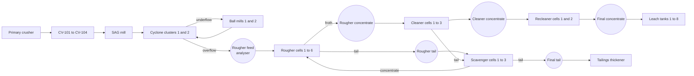

# Plant knowledge: Example Mining, Site A, Concentrator 1

What the site's metallurgists know about this concentrator and its historian tags. Given to the agent in the
"plant knowledge" conditions of No. 5, appended to its system prompt. Every Example Mining concentrator has the
same layout; this note is for Site A, Concentrator 1.

## Flowsheet

- The ore is fed by the SAG mill's **Fresh Feed Rate** (t/h); it is the concentrator's throughput.
- The online analyser samples six streams (circles above): Rougher Feed, Rougher Concentrate, Rougher Tail, Cleaner
  Concentrate, Final Concentrate and Final Tail, each with Au and Ag (g/t), Pb and S (%) and Solids (%). One value per
  15-minute cycle. The rougher feed is the flotation feed: its Au is the **feed grade**.
- Reagents are dosed at the rougher feed: Collector, Frother, Depressant, Activator. Each **Dose Rate** tag is the
  dosing pump's flow in mL/min, not a dose per tonne of ore; per tonne, divide by the fresh feed rate.

## How the site calculates its numbers

There is **no recovery tag** in the historian. The site calculates recovery from the analyser's Au assays with the
two-product formula, where f, c and t are the feed, concentrate and tail Au of the same period:

    recovery (%) = 100 × c (f − t) / (f (c − t))
    mass pull (%) = 100 × (f − t) / (c − t)          (share of the feed reporting to the concentrate)

| Number | Feed (f) | Concentrate (c) | Tail (t) |
|---|---|---|---|
| **Gold recovery** (the plant's reported recovery: "recovery" with no other word means this one) | Rougher Feed Au | Final Concentrate Au | Final Tail Au |
| Rougher recovery | Rougher Feed Au | Rougher Concentrate Au | Rougher Tail Au |
| Rougher mass pull | Rougher Feed Au | Rougher Concentrate Au | Rougher Tail Au |

- **Running hours only.** The concentrator is stopped when the fresh feed rate is under 50 t/h; the site leaves
  stopped periods out of every number it reports. While stopped, the analyser holds its last values.
- Tag paths: `\\EXAMPLE-AF\Operations\Example Mining\Site A\Concentrator 1\Flotation\<stream>|Au`, for example
  `...\Flotation\Final Tail|Au`; the feed rate is `...\Grinding\SAG Mill|Fresh Feed Rate`; the collector is
  `...\Flotation\Collector|Dose Rate`.
